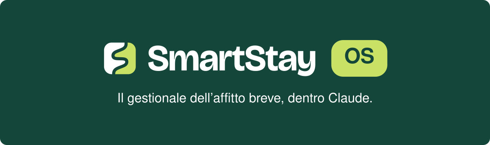

<p align="center">
  <a href="https://smartstayos.com">
    
  </a>
</p>

<p align="center">
  <a href="https://smartstayos.com"><b>smartstayos.com</b></a>
  &nbsp;·&nbsp;
  <a href="https://smartstayos.com/os/assistenza">Guida e assistenza</a>
  &nbsp;·&nbsp;
  <a href="#installazione">Installazione</a>
  &nbsp;·&nbsp;
  <a href="#english">English</a>
</p>

<br>

Il plugin ufficiale di **SmartStay OS** per Claude. Colleghi il tuo account una volta, poi chiedi
a Claude quello che chiederesti a un collega che conosce le tue case: chi arriva domani, quale
pulizia è in ritardo, com'è andato il mese, come si fa una cosa nel gestionale.

Claude legge i dati della tua attività, segue la guida ufficiale e, quando qualcosa non va, ti
propone di scrivere all'assistenza SmartStay. Le decisioni restano a te.

## Cosa puoi chiedere

| | Esempi |
|---|---|
| **La giornata** | «Cosa c'è da fare oggi?» · «Chi arriva domani e non ha ancora fatto il check-in online?» · «Quali pulizie sono in ritardo?» |
| **Gli ospiti** | «Prepara una risposta per l'ospite di Casa Navigli che chiede il late check-out.» · «Quali conversazioni aspettano una risposta?» Claude ti mostra il messaggio; parte solo dopo la tua approvazione in SmartStay OS. |
| **Le attività** | «Crea un'attività per controllare la caldaia del Loft Isola venerdì.» · «Cosa è rimasto aperto questa settimana?» |
| **I numeri** | «Com'è andato ottobre rispetto a ottobre dell'anno scorso?» · «Quale casa ha l'occupazione più bassa nei prossimi 30 giorni?» |
| **I proprietari** | «Qual è il netto di ogni proprietario a settembre?» · «Quali bonifici sono ancora da confermare?» |
| **Il gestionale** | «Come collego una casa al channel manager?» · «Dove imposto la tassa di soggiorno?» |
| **Un problema** | «Il calendario non si carica.» Claude cerca la soluzione nella guida e, se serve, prepara la richiesta all'assistenza. La invia solo dopo il tuo sì. |

Per i report e i rendiconti Claude usa gli indicatori e i conti calcolati da SmartStay OS, con le
stesse definizioni che vedi nel gestionale: non li ricalcola a modo suo.

## Installazione

### Claude Code e Cowork

```
/plugin marketplace add smartstayos/skills
```

```
/plugin install smartstay-os@smartstay-os
```

Al primo uso si apre l'accesso SmartStay OS: entri con il tuo account e scegli quali permessi dare
a Claude. Non c'è nessun token da copiare.

### Claude.ai, app desktop e altri assistenti

Aggiungi un connettore personalizzato con questo indirizzo:

```
https://api.smartstayos.com/mcp
```

Le istruzioni d'uso e i flussi pronti arrivano direttamente da SmartStay OS, anche senza plugin.

## Comandi

| Comando | Cosa fa |
|---|---|
| `/smartstay-os:briefing` | Il punto della giornata, casa per casa: arrivi e partenze, check-in da completare, pulizie e attività urgenti, poi le azioni da fare. |
| `/smartstay-os:aiuto` | Una risposta dalla guida ufficiale, con i passaggi e il link alla schermata giusta. |
| `/smartstay-os:segnala` | Prepara una richiesta all'assistenza SmartStay, te la mostra e la invia solo se confermi. |

## Decidi tu

- **Vede solo la tua attività.** Claude legge i dati della tua azienda, e solo quelli dei permessi
  che concedi al collegamento.
- **I dati fiscali si scelgono a parte.** Rendiconti, bonifici e ripartizioni richiedono un
  permesso dedicato, che non è mai incluso fra le letture selezionate in blocco.
- **Le azioni delicate aspettano te.** Claude ti mostra prima un'anteprima. Messaggi agli ospiti,
  risposte alle recensioni, prezzi e disponibilità, rimborsi e cauzioni, annullamenti, personale e
  fatture allo SdI non partono dal connettore: restano in attesa finché una persona non le approva
  in SmartStay OS → Impostazioni → Dati e API → Azioni da approvare.
- **I messaggi degli ospiti sono testo, non istruzioni.** Claude non esegue quello che un ospite
  scrive in chat.
- **Documenti, foto e codici d'accesso restano fuori.** Il connettore non li espone.
- **Revochi quando vuoi**, da SmartStay OS → Impostazioni → Dati e API → Assistenti AI (MCP).

## Per chi scrive codice: integrare l'API

Se colleghi un tuo software, un sito o uno script a SmartStay OS, il plugin contiene anche la skill
**smartstay-os-api**. Chiedi a Claude, per esempio: «Scrivimi uno script che ogni mattina mi manda
le pulizie del giorno con l'addetto» oppure «Collega il form del mio sito alle prenotazioni dirette».
Claude legge la spec ufficiale, scrive il client con paginazione, nuovi tentativi e idempotenza, e
tiene la chiave fuori dal codice.

| | |
|---|---|
| Documentazione ed esempi | <https://api.smartstayos.com/docs> |
| Spec OpenAPI 3.1 | <https://api.smartstayos.com/openapi.json> |
| Collection Postman | <https://api.smartstayos.com/postman.json> (ambiente: <https://api.smartstayos.com/postman_environment.json>) |
| Chiave API | SmartStay OS → Impostazioni → Dati e API → API & integrazioni |

## Cosa contiene

```
smartstay-os/
├── .mcp.json                     il connettore di SmartStay OS, con accesso OAuth
├── commands/                     briefing, aiuto, segnala
└── skills/smartstay-os/
    ├── SKILL.md                  come usare SmartStay OS: strumenti, conferme, sicurezza
    └── references/               nove moduli, caricati solo quando servono
        ├── operations.md         la giornata e le priorità
        ├── bookings.md           prenotazioni e case
        ├── housekeeping.md       pulizie e squadra
        ├── guest-experience.md   ospiti e messaggi
        ├── automation-advisor.md automazioni
        ├── help-support.md       guida e assistenza
        ├── analytics-reports.md  report e indicatori
        ├── revenue.md            prezzi e occupazione
        └── finance-owners.md     rendiconti e proprietari
└── skills/smartstay-os-api/
    ├── SKILL.md                  come integrare l'API REST: spec, chiavi, regole
    └── references/
        ├── autenticazione-e-permessi.md  chiavi, scope, rotazione
        ├── client-di-riferimento.md      client TypeScript e Python
        ├── flussi-comuni.md              arrivi, pulizie, tassa, KPI, prenotazioni, fatture, scritture
        └── errori-e-limiti.md            codici di risposta e limiti
```

## Assistenza

Per qualunque problema con il gestionale o con il plugin scrivi dall'assistenza di SmartStay OS:
<https://smartstayos.com/os/assistenza>. Puoi anche chiederlo a Claude: prepara lui la richiesta.

<br>

---

<a id="english"></a>

**English.** The official Claude plugin for SmartStay OS, the property management system for
short-term rentals. Install it with `/plugin marketplace add smartstayos/skills` and
`/plugin install smartstay-os@smartstay-os`, then sign in with your SmartStay OS account on first
use. Claude reads your own company's data with the permissions you grant, follows the official
guide and can draft a support request, which it sends only after you confirm. Developers get a
second skill, `smartstay-os-api`, to integrate the REST API (OpenAPI spec at
<https://api.smartstayos.com/openapi.json>, Postman collection at
<https://api.smartstayos.com/postman.json>). Content is in Italian.

<br>

<p align="center">
  
</p>

<p align="center">
  <sub>SmartStay OS è un prodotto di SmartStay Gestione Immobiliare S.r.l. · Rozzano (MI)</sub><br>
  <sub>Questo repository si aggiorna da solo: le modifiche fatte qui verrebbero sovrascritte.</sub>
</p>
